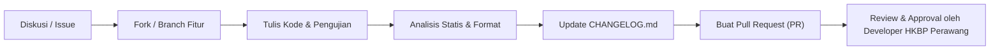

# Panduan Kontribusi — Aplikasi HKBP Perawang

Terima kasih atas ketertarikan Anda untuk berkontribusi pada pengembangan **Aplikasi & Portal Digital HKBP Perawang**! Dokumen ini menjadi pedoman resmi bagi siapa saja yang ingin ikut serta dalam memajukan sistem informasi gereja.

---

## 1. Status Kepemilikan & Kebijakan Lisensi

> [!IMPORTANT]
> **Proyek ini dilisensikan secara resmi kepada Tim Multimedia HKBP Perawang dan BUKAN merupakan perangkat lunak sumber terbuka (non-open source / proprietary).**
>
> Seluruh kode sumber, aset desain, dan arsitektur sistem adalah milik hak cipta **Gereja HKBP Perawang & Tim Multimedia HKBP Perawang**.
>
> **Kebijakan Partisipasi:**  
> Meskipun proyek ini bukan *open source*, **semua pihak diperbolehkan ikut serta dalam proses pengembangan**. Namun demikian, setiap kontribusi, modifikasi kode, penambahan fitur, atau perbaikan bug **akan dipantau secara ketat dan wajib disetujui oleh Developer HKBP Perawang (Tim Multimedia Devisi Digital)** sebelum dapat digabungkan (*merged*) ke cabang produksi.

---

## 2. Saluran Komunikasi & Kontak Pengembang

Untuk koordinasi, konsultasi teknis, atau pertanyaan sebelum memulai pengerjaan, silakan hubungi tim kami:

- **Developer / Pengembang (Tim Multimedia Devisi Digital)**: `dev@hkbpperawang.org`  
  *(Diskusi teknis, review Pull Request, arsitektur data, dan koordinasi pengembangan)*
- **Layanan Pengaduan & Support**: `support@hkbpperawang.org`  
  *(Laporan kendala kontribusi, bug sistem, atau bantuan operasional)*
- **Informasi Resmi**: `informasi@hkbpperawang.org`  
  *(Pertanyaan terkait warta, jadwal, kebijakan gereja, dan verifikasi info resmi)*
- **Kontak Kantor Gereja**: `kontak@hkbpperawang.org`  
  *(Administrasi umum dan kesekretariatan gereja)*

---

## 3. Standar Koding & Konvensi Proyek

Sebelum menulis atau mengubah kode, kontributor **wajib** mematuhi pedoman teknis yang berlaku di repositori ini:

### Arsitektur & State Management
- **Pola Provider (`ChangeNotifier`)**: State management reaktif menggunakan kelas yang mewarisi `ChangeNotifier` dan memperbarui antarmuka melalui `notifyListeners()`.
- **Dilarang keras** memperkenalkan framework state management alternatif (misal: BLoC, Riverpod, GetX) tanpa persetujuan eksplisit Tim Developer.

### Strategi Konektivitas & Mode Offline (CacheFirst)
- `lib/providers/connectivity_provider.dart` adalah *Single Source of Truth* untuk deteksi konektivitas jaringan, status sinkronisasi, dan grace period.
- Caching dan antrean offline dikelola melalui `lib/utils/data_cache_manager.dart`, `lib/utils/storage.dart`, dan `lib/utils/offline/offline_diff_queue.dart`.

### Pemodelan Data & Serialisasi
- Semua data model menggunakan **pemetaan manual** (`fromMap`/`toMap` atau `fromJson`/`toJson`) dengan validasi fallback defensif (misal: `map['title'] ?? ''`).
- **Dilarang** menambahkan `@JsonSerializable` atau `@freezed` untuk model data umum.
- `build_runner` hanya diperbolehkan untuk generator **Hive CE TypeAdapters** (`hive_ce_generator`) dan mocks pengujian.

### Kebijakan Media & Penyimpanan Cloud
- **Firebase Storage TIDAK DIGUNAKAN** (keterbatasan Spark plan / free tier).
- Semua unggahan media, foto profil, warta PDF, dan gambar **wajib menggunakan ImageKit (`ImageKitService` / `uploadBytes`)** atau Google Drive.
- Dilarang mengunggah langsung ke Google Cloud Storage bucket atau mengonfigurasi CORS GCP.

### Multiplatform & Kompatibilitas Web
- Panggilan ke `FirebaseCrashlytics` dan `FlutterNativeSplash.preserve` **wajib dibungkus pengecekan `if (!kIsWeb)`** untuk menghindari runtime exception pada web.
- Build release web wajib menyertakan argumen `--no-tree-shake-icons`.
- Jangan menghapus atau mengubah 3-layer anti-indexing pada portal admin web (`web/robots.txt`, meta robots di `web/index.html`, dan header `firebase.json`).

### Widget & Best Practices Flutter
- **ReorderableListView**: Selalu gunakan `onReorderItem` (bukan `onReorder` yang sudah usang/deprecated) dan **tanpa** pengurangan indeks manual (`newIndex -= 1`).
- **Transparansi Warna**: Gunakan `Color.withAlpha(int)` daripada `.withOpacity(double)`.
- **Logging**: Dilarang menggunakan `print()` atau `debugPrint()`. Selalu gunakan `AppLogger` dari `lib/utils/network_monitor/logger.dart`.
- **Async Context**: Hindari penggunaan `BuildContext` melintasi async gap tanpa pengecekan `if (!mounted) return;`.

### Lingkungan Java Android (Khusus Windows)
- Proyek ini menggunakan **Java JDK 17**. Sebelum menjalankan build atau eksekusi Gradle di Windows, selalu setel variabel lingkungan:
  ```powershell
  $env:JAVA_HOME = "D:\Programs\Java\jdk-17"; flutter build apk
  ```

---

## 4. Alur Kerja Kontribusi (Workflow)

Ikuti langkah-langkah berikut untuk mengajukan perubahan:



1. **Koordinasi Awal**:
   Buka *Issue* baru di GitHub atau hubungi `dev@hkbpperawang.org` untuk mendiskusikan ide fitur baru atau perbaikan yang ingin dikerjakan.
2. **Branching**:
   Buat branch baru dari branch utama (`main`) dengan format nama yang jelas:
   - `feat/nama-fitur` untuk fitur baru
   - `fix/nama-perbaikan` untuk perbaikan bug
   - `docs/nama-dokumen` untuk perbaikan dokumentasi
3. **Pengembangan & Uji Mandiri**:
   - Terapkan perubahan seminimal mungkin (*surgical diffs*), hindari refactoring tak berdasar pada file lain.
   - Jalankan analisis statis:
     ```powershell
     flutter analyze
     ```
   - Pastikan tidak ada peringatan (*warnings*) atau kesalahan (*errors*).
4. **Pembaruan Dokumen Perubahan (*CHANGELOG.md*)**:
   - Wajib mencatat ringkasan perubahan di `CHANGELOG.md` pada rilis terkait dengan urutan kronologis teratas (descending).
5. **Pengajuan Pull Request (PR)**:
   - Buat PR ke branch utama dengan menyertakan deskripsi lengkap:
     - Latar belakang masalah / tujuan perubahan.
     - Ringkasan solusi teknis yang diterapkan.
     - Tangkapan layar (*screenshot*) atau demonstrasi visual jika melibatkan antarmuka pengguna.
6. **Pemantauan & Persetujuan (Review & Approval)**:
   - Developer HKBP Perawang (Tim Multimedia Devisi Digital) akan meninjau setiap baris perubahan.
   - Tim pengembang berhak meminta penyesuaian kode atau menolak perubahan yang tidak memenuhi standar arsitektur dan keamanan.

---

## 5. Etika Berkontribusi

Setiap kontributor wajib menghormati dan mematuhi [Kode Etik (CODE_OF_CONDUCT.md)](CODE_OF_CONDUCT.md) serta [Pedoman Konten (legal/content-guidelines.md)](https://aplikasi.hkbpperawang.org/legal/content-guidelines) yang berlaku di lingkungan HKBP Perawang.

---

## 6. Referensi Dokumen Legal

- [Lisensi Proprietary Proyek](LICENSE)
- [Kebijakan Hak Cipta & DMCA](https://aplikasi.hkbpperawang.org/legal/copyright-policy)
- [Kebijakan Keamanan](SECURITY.md) & [Security Policy](https://aplikasi.hkbpperawang.org/legal/security-policy)
- [Ketentuan Penggunaan](https://aplikasi.hkbpperawang.org/legal/terms-of-use)

---

© 2024–2026 Gereja HKBP Perawang & Tim Multimedia HKBP Perawang (Devisi Digital). All Rights Reserved.
